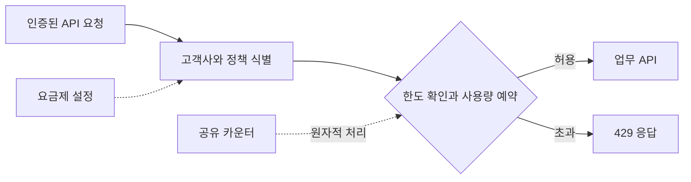

> [!info] 마케스트림 docs에서 이관한 기록
> 이전 경로: `docs/concepts/backend/api-gateway.md` · 이관일: 2026-11-16 · 원본 정리일: 2026-11-16. 이관 후 사용자의 요청으로 원본 파일을 정리했다. 본문 안의 날짜·구현·검증·학습 상태는 작성 당시의 기록이며, 이관·삭제만으로 현재 상태를 다시 검증한 것은 아니다.
> [이관 목차](../../projects/markestream/imported-learning.md) · [현재 대화·자기 언어 학습 방법](../../learning-workflow.md)

# API Gateway와 사용량 제한

- 갱신: 2026-11-11
- 학습 상태: 학습 중
- 프로젝트 적용: 별도 Gateway·Redis 사용량 제한 미구현
- 실험 상태: 미실행

## 한 문장으로

API Gateway는 여러 API 앞에서 인증 연동, 라우팅, 요청 제한 같은 공통 정책을 적용하는 역할을 맡을 수 있다.

## 왜 필요한가?

고객사가 API를 직접 연동할 때 누가 어떤 API를 얼마나 쓸 수 있는지 관리할 수 있다. 자체 웹 화면과 API를 운영한다는 사실만으로 별도 Gateway가 반드시 필요한 것은 아니다.

## 어떻게 동작하는가?

다음은 직접 구현하는 일일 할당량 제한의 학습용 흐름이다. 마케스트림의 현재 요청 경로는 아니다.

요금제 같은 설정과 자주 갱신되는 사용량을 구분할 수 있다. 여러 인스턴스가 같은 한도를 적용하려면 공유 상태가 필요하다. Redis Lua는 한도 확인과 증가를 다른 요청이 끼어들지 못하게 묶는 구현 수단 중 하나다. [Redis Lua 원자적 실행](https://redis.io/docs/latest/develop/programmability/eval-intro/)

## 내가 질문했던 부분

최근 대화에서 “Gateway도 백엔드처럼 사용량을 가져오고, 응답을 보낸 뒤 남은 사용량을 줄이는가?”를 질문했다.

한 번 남았을 때 두 요청이 동시에 들어오면 `조회 → 업무 처리 → 차감` 방식은 둘 다 통과시킬 수 있다. 엄격한 제한이 목적이면 허용 판단과 예약을 원자적으로 처리한다. 실패한 요청을 돌려줄지, 성공만 과금할지, 재시도는 어떻게 셀지는 별도 정책이다. Redis 장애와 데이터 유실까지 해결해야 과금의 정확성을 논할 수 있다.

| 구분 | 예시 | 질문 |
| --- | --- | --- |
| Rate Limit | 짧은 시간의 요청 속도 제한 | 순간 트래픽을 어떻게 제어할까? |
| Quota | 하루·월별 총량 제한 | 어떤 시간대와 기준으로 초기화할까? |
| 업무 과금 | 성공한 보고서 생성 수 | 실패·재시도를 어떻게 처리할까? |

AWS API Gateway REST API의 Usage Plan 제한은 best effort이며 엄격한 상한 보장이 아니다. API Key를 인증·인가 자체로 사용해서도 안 된다. [AWS Usage Plan 문서](https://docs.aws.amazon.com/apigateway/latest/developerguide/api-gateway-api-usage-plans.html)

## 마케스트림에서는?

현재 [SecurityConfiguration](file:///Users/dhkim/Desktop/ml-project/markestream/backend/admin-api/src/main/java/com/markestream/admin/common/security/SecurityConfiguration.java)이 JWT를 검증하고 [WorkspaceAccessService](file:///Users/dhkim/Desktop/ml-project/markestream/backend/admin-api/src/main/java/com/markestream/admin/permission/application/PermissionAccessService.java)가 대행사 소속과 역할을 확인한다. Redis나 일일 할당량 코드와 설정은 확인되지 않았다.

공개 문의폼은 외부 기업용 API와 요구가 다르다. [제품 설계](../../projects/markestream/reference/02-system-architecture.md)의 문의 접수에는 별도의 스팸 방어·요청 제한이 필요하며, 대행사의 비밀 키를 방문자 브라우저에 넣는 방식으로 해결하지 않는다.

## 실제로 검증했는가?

미실행. 향후 “한도 한 번 남음 + 동시 요청 둘”을 시작으로 실패·재시도·카운터 장애를 각각 확인한다.

## 문서를 덮고 답하기

1. 응답 뒤에만 차감하면 어떤 경쟁이 생길까?
2. Gateway 인증 성공 후에도 업무 API가 대행사 소속을 검사하는 이유는?
3. 일일 할당량과 공개 문의폼 스팸 방어가 같은 요구인가?

내 설명 / 복습 날짜: 아직 작성하지 않음.

[현재 요청 흐름](../../projects/markestream/architecture/system-overview.md) · [위키 목차](../../projects/markestream/imported-guides/README.md)

공식 자료 확인일: 2026-11-11.

## 공통 학습 보관함에서 이어가기

[네트워크·요청 흐름 Canvas](../../maps/network-request-flow.canvas) · [함께 이관한 개념과 프로젝트 자료](../../projects/markestream/imported-learning.md)

원문에 있는 내 설명·복습 기록을 유지한다. 아직 작성하지 않은 자기 설명을 이관 과정에서 대신 채우지 않았다. 앞으로의 대화에서 이해한 내용을 자기 말로 이어 적는다.
