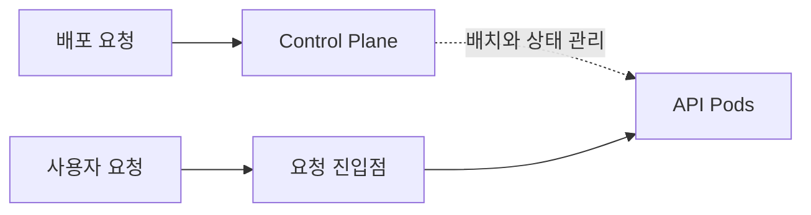

> [!info] 마케스트림 docs에서 이관한 기록
> 이전 경로: `docs/concepts/kubernetes/control-plane.md` · 이관일: 2026-11-16 · 원본 정리일: 2026-11-16. 이관 후 사용자의 요청으로 원본 파일을 정리했다. 본문 안의 날짜·구현·검증·학습 상태는 작성 당시의 기록이며, 이관·삭제만으로 현재 상태를 다시 검증한 것은 아니다.
> [이관 목차](../../projects/markestream/imported-learning.md) · [현재 대화·자기 언어 학습 방법](../../learning-workflow.md)

# Control Plane

- 갱신: 2026-11-11
- 학습 상태: 학습 중
- 프로젝트 적용: 스테이징 설계 초안
- 실험 상태: 미실행

## 한 문장으로

Control Plane은 클러스터의 원하는 상태와 현재 상태를 관리하며, Pod 배치와 복제본 유지 등의 제어를 수행한다.

## 왜 필요한가?

“API 두 개를 유지한다”는 요구가 있을 때, 실행 상태가 달라졌음을 감지하고 다시 맞추는 관리 기능이 필요하다.

## 어떻게 동작하는가?

| 구성 요소 | 맡는 일 |
| --- | --- |
| API Server | 클러스터 API의 진입점 |
| etcd | 클러스터 상태 데이터 저장 |
| Scheduler | 아직 배치되지 않은 Pod의 Node 선정 |
| Controller Manager | 원하는 상태를 유지하기 위한 제어 루프 실행 |
| Node의 kubelet | 해당 Node에서 Pod 실행 상태 관리 |

[Kubernetes 구성 요소](https://kubernetes.io/docs/concepts/overview/components/)

점선은 관리 관계다. 일반적인 애플리케이션 요청마다 Control Plane을 통과하는 구조는 아니다.

## 헷갈린 점

Control Plane은 ALB처럼 사용자 요청을 매번 분산하는 장치가 아니다. 제어 영역에 장애가 생겨도 이미 실행 중인 앱과 설정된 전달 경로는 계속 동작할 수 있지만, 배포·새 스케줄링·상태 갱신은 영향을 받는다. 따라서 “제어 노드가 죽어도 아무 문제 없다”로 이해하면 안 된다.

## 마케스트림에서는?

[스테이징 설계](../../projects/markestream/reference/05-project-cicd.md)의 제어 노드 1대는 단일 장애 지점이 있다. 학습용 구성에서 관찰할 제약이며 운영 가용성이 검증된 구성이 아니다.

## 실제로 검증했는가?

미실행. 먼저 [Pod 복구 실험](../../projects/markestream/labs/pod-failover.md)을 하고, 제어 영역 장애는 별도 환경·복구 절차를 갖춘 실험으로 분리한다.

## 문서를 덮고 답하기

1. 사용자 요청 경로와 배포 제어 경로를 따로 그릴 수 있는가?
2. 제어 노드 장애 때 기존 요청 처리와 새 Pod 배치를 왜 구분해야 할까?

내 설명 / 복습 날짜: 아직 작성하지 않음.

[ALB](../traffic/alb.md) · [위키 목차](../../projects/markestream/imported-guides/README.md)

공식 자료 확인일: 2026-11-11.

## 공통 학습 보관함에서 이어가기

[네트워크·요청 흐름 Canvas](../../maps/network-request-flow.canvas) · [함께 이관한 개념과 프로젝트 자료](../../projects/markestream/imported-learning.md)

원문에 있는 내 설명·복습 기록을 유지한다. 아직 작성하지 않은 자기 설명을 이관 과정에서 대신 채우지 않았다. 앞으로의 대화에서 이해한 내용을 자기 말로 이어 적는다.
