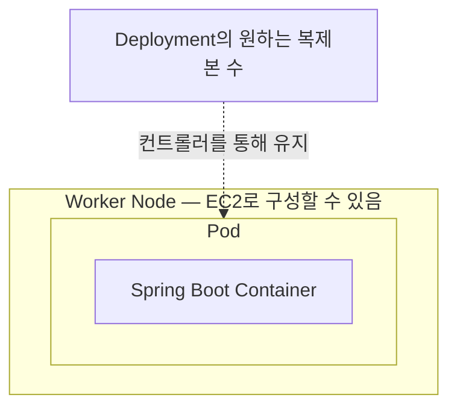

> [!info] 마케스트림 docs에서 이관한 기록
> 이전 경로: `docs/concepts/kubernetes/node-pod.md` · 이관일: 2026-11-16 · 원본 정리일: 2026-11-16. 이관 후 사용자의 요청으로 원본 파일을 정리했다. 본문 안의 날짜·구현·검증·학습 상태는 작성 당시의 기록이며, 이관·삭제만으로 현재 상태를 다시 검증한 것은 아니다.
> [이관 목차](../../projects/markestream/imported-learning.md) · [현재 대화·자기 언어 학습 방법](../../learning-workflow.md)

# Node와 Pod

- 갱신: 2026-11-11
- 학습 상태: 학습 중
- 프로젝트 적용: Kubernetes 배포 설정 미구현
- 실험 상태: 미실행

## 한 문장으로

Node는 Kubernetes가 작업을 실행하는 머신이고, Pod는 함께 배치되는 컨테이너의 실행 단위다.

## 왜 필요한가?

API를 여러 머신에서 실행할 때 “어떤 프로세스를 몇 개 유지할까?”와 “어느 머신에서 실행할까?”를 구분해서 관리해야 한다.

## 어떻게 동작하는가?

EC2를 Node로 사용할 수 있지만 모든 Node가 EC2인 것은 아니다. Pod에는 하나 또는 긴밀하게 함께 동작하는 여러 컨테이너가 들어갈 수 있다. 교체된 Pod는 이전 Pod와 다른 개체이며 IP도 달라질 수 있다. [Kubernetes Pod 문서](https://kubernetes.io/docs/concepts/workloads/pods/)

Deployment는 ReplicaSet을 통해 원하는 복제본을 유지한다. 컨테이너의 로컬 재시작과 새 Pod 생성은 구분한다. Node가 사라졌을 때 복구에는 감지, 재배치 가능한 용량과 제약, 이미지와 저장소 접근 등이 관여한다. [Kubernetes Deployment 문서](https://kubernetes.io/docs/concepts/workloads/controllers/deployment/)

## 헷갈린 점

“Pod 두 개”가 “서버 두 대에 하나씩”을 자동으로 보장하지 않는다. 어느 Node에 배치됐는지와 분산 설정을 확인해야 한다. Pod를 지우는 실험도 Node 전체 장애와는 다르다.

## 마케스트림에서는?

[스테이징 설계](../../projects/markestream/reference/05-project-cicd.md)는 제어 노드 1대와 워커 2대, API 복제본 2개를 제안한다. 현재 저장소에는 이를 적용할 `infra/k8s/` 매니페스트가 없다. 로컬 `bootRun`을 Kubernetes Pod 실행으로 기록하지 않는다.

## 실제로 검증했는가?

미실행. [Pod 복구 실험](../../projects/markestream/labs/pod-failover.md)에 준비 조건과 관찰 항목을 정리했다.

## 문서를 덮고 답하기

1. EC2·Node·Pod·Container의 관계를 그릴 수 있는가?
2. Pod 두 개가 같은 Node에 있으면 Node 장애 때 어떤 일이 생길까?

내 설명 / 복습 날짜: 아직 작성하지 않음.

[Control Plane](control-plane.md) · [위키 목차](../../projects/markestream/imported-guides/README.md)

공식 자료 확인일: 2026-11-11.

## 공통 학습 보관함에서 이어가기

[네트워크·요청 흐름 Canvas](../../maps/network-request-flow.canvas) · [함께 이관한 개념과 프로젝트 자료](../../projects/markestream/imported-learning.md)

원문에 있는 내 설명·복습 기록을 유지한다. 아직 작성하지 않은 자기 설명을 이관 과정에서 대신 채우지 않았다. 앞으로의 대화에서 이해한 내용을 자기 말로 이어 적는다.
