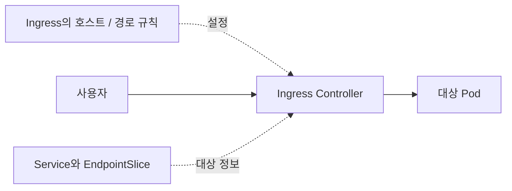

> [!info] 마케스트림 docs에서 이관한 기록
> 이전 경로: `docs/concepts/kubernetes/service-ingress.md` · 이관일: 2026-11-16 · 원본 정리일: 2026-11-16. 이관 후 사용자의 요청으로 원본 파일을 정리했다. 본문 안의 날짜·구현·검증·학습 상태는 작성 당시의 기록이며, 이관·삭제만으로 현재 상태를 다시 검증한 것은 아니다.
> [이관 목차](../../projects/markestream/imported-learning.md) · [현재 대화·자기 언어 학습 방법](../../learning-workflow.md)

# Service와 Ingress

- 갱신: 2026-11-11
- 학습 상태: 학습 중
- 프로젝트 적용: 스테이징 설계 초안
- 실험 상태: 미실행

## 한 문장으로

Service는 바뀌는 Pod 집합에 안정적인 접근 방법을 제공하고, Ingress는 HTTP(S) 요청을 호스트·경로에 따라 어느 Service로 연결할지 선언한다.

## 왜 필요한가?

Pod IP가 바뀔 때마다 호출자가 주소를 수정하게 만들 수는 없다. 또한 관리자 API와 공개 문의 API를 서로 다른 호스트나 경로로 연결해야 한다.

## 어떻게 동작하는가?

일반적인 selector 기반 Service는 라벨로 Pod 집합을 가리키며 EndpointSlice에 대상 엔드포인트가 표현된다. ClusterIP Service는 클러스터 내부의 접근 지점을 제공한다. [Kubernetes Service 문서](https://kubernetes.io/docs/concepts/services-networking/service/)

Ingress 리소스만 작성해서는 요청 전달이 실행되지 않는다. Traefik 같은 Ingress Controller가 필요하다. [Kubernetes Ingress 문서](https://kubernetes.io/docs/concepts/services-networking/ingress/)

그림은 Traefik이 Pod로 직접 연결하는 방식을 예로 들었다. Service를 참조한다고 모든 패킷이 반드시 ClusterIP를 경유하는 것은 아니다. Traefik은 설정에 따라 Pod IP 직접 연결 또는 Service ClusterIP 경유를 사용할 수 있다. [Traefik 라우팅 문서](https://doc.traefik.io/traefik/reference/routing-configuration/kubernetes/ingress/)

## 헷갈린 점

Service는 요청마다 실행되는 별도 백엔드 프로그램을 뜻하지 않는다. Ingress는 규칙이고, Controller는 그 규칙을 실제로 처리하는 구현이다. “Gateway”라는 이름의 Kubernetes Gateway API와 고객사 API 사용 정책을 처리하는 API Gateway 제품도 같은 개념은 아니다.

## 마케스트림에서는?

[설계](../../projects/markestream/reference/02-system-architecture.md)는 관리자·공개 호스트의 라우팅을 구분한다. 현재 [Vite 프록시](file:///Users/dhkim/Desktop/ml-project/markestream/apps/admin-web/vite.config.ts)는 로컬 `/admin/v1`을 Admin API로 전달하며 Kubernetes Service·Ingress 설정은 아직 없다.

## 실제로 검증했는가?

미실행. 구축 후 선택한 Controller 버전, 라벨, readiness, EndpointSlice, 실제 전달 경로를 함께 관찰한다.

## 문서를 덮고 답하기

1. Service와 Pod를 하나의 고정 서버처럼 생각하면 어떤 점을 놓칠까?
2. Ingress YAML은 있는데 Controller가 없다면 무엇이 실행되지 않을까?

내 설명 / 복습 날짜: 아직 작성하지 않음.

[Traefik](../traffic/traefik.md) · [위키 목차](../../projects/markestream/imported-guides/README.md)

공식 자료 확인일: 2026-11-11.

## 공통 학습 보관함에서 이어가기

[네트워크·요청 흐름 Canvas](../../maps/network-request-flow.canvas) · [함께 이관한 개념과 프로젝트 자료](../../projects/markestream/imported-learning.md)

원문에 있는 내 설명·복습 기록을 유지한다. 아직 작성하지 않은 자기 설명을 이관 과정에서 대신 채우지 않았다. 앞으로의 대화에서 이해한 내용을 자기 말로 이어 적는다.
