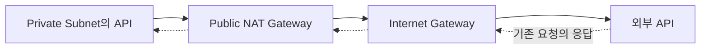

> [!info] 마케스트림 docs에서 이관한 기록
> 이전 경로: `docs/concepts/networking/nat-gateway.md` · 이관일: 2026-11-16 · 원본 정리일: 2026-11-16. 이관 후 사용자의 요청으로 원본 파일을 정리했다. 본문 안의 날짜·구현·검증·학습 상태는 작성 당시의 기록이며, 이관·삭제만으로 현재 상태를 다시 검증한 것은 아니다.
> [이관 목차](../../projects/markestream/imported-learning.md) · [현재 대화·자기 언어 학습 방법](../../learning-workflow.md)

# NAT Gateway

- 갱신: 2026-11-11
- 학습 상태: 학습 중
- 프로젝트 적용: 도입 여부 미확정
- 실험 상태: 미실행

## 한 문장으로

NAT Gateway는 내부 서버가 시작한 연결의 주소를 변환하고 응답을 되돌려주는 AWS 서비스다. 여기서는 프라이빗 서버의 IPv4 인터넷 접속을 위한 Public NAT Gateway를 다룬다.

## 왜 필요한가?

프라이빗 서버도 패키지 다운로드나 외부 광고 API 호출이 필요할 수 있다. 서버에 직접 공인 IPv4를 부여하지 않는 구성에서는 외부로 나갈 경로가 필요하다.

## 어떻게 동작하는가?

Private Subnet의 외부 목적지 경로를 NAT 쪽으로 연결하고, Public NAT는 Internet Gateway를 통해 인터넷과 통신한다. 외부 서비스가 이 NAT를 통해 내부 서버로 임의의 새 연결을 시작할 수는 없다. [AWS NAT Gateway 문서](https://docs.aws.amazon.com/vpc/latest/userguide/vpc-nat-gateway.html)

## 헷갈린 점

“외부 API의 응답을 받는다”와 “외부 사용자의 새 요청을 받는다”를 구분한다. 방문자의 문의 제출은 공개 진입점에서 Inquiry API로 가는 별도 흐름이다. NAT Gateway를 설치했다고 공개 API 주소가 생기지 않는다.

## 마케스트림에서는?

이전 채팅의 학습 예시에는 테스트 환경에서 NAT를 제외하는 안이 있었다. 실제 AWS 네트워크 설정과 확정 ADR은 현재 저장소에서 확인하지 못했다. 제외 여부는 노드의 이미지·패키지 다운로드, 외부 API 접근 경로를 확인한 뒤 결정할 항목이다.

## 실제로 검증했는가?

미실행. 향후 테스트 서버에서 목적지, DNS 해석, 라우팅, 응답을 각각 기록한다. 로컬 Mac의 인터넷 접속 성공은 AWS NAT 구성의 증거가 아니다.

## 문서를 덮고 답하기

1. 외부 API 응답은 돌아오는데 외부에서 새 연결을 시작할 수 없는 이유는?
2. NAT를 제외한다면 무엇의 외부 통신 경로를 먼저 확인해야 할까?

내 설명 / 복습 날짜: 아직 작성하지 않음.

[VPC와 Subnet](vpc-subnet.md) · [위키 목차](../../projects/markestream/imported-guides/README.md)

공식 자료 확인일: 2026-11-11.

## 공통 학습 보관함에서 이어가기

[네트워크·요청 흐름 Canvas](../../maps/network-request-flow.canvas) · [함께 이관한 개념과 프로젝트 자료](../../projects/markestream/imported-learning.md)

원문에 있는 내 설명·복습 기록을 유지한다. 아직 작성하지 않은 자기 설명을 이관 과정에서 대신 채우지 않았다. 앞으로의 대화에서 이해한 내용을 자기 말로 이어 적는다.
