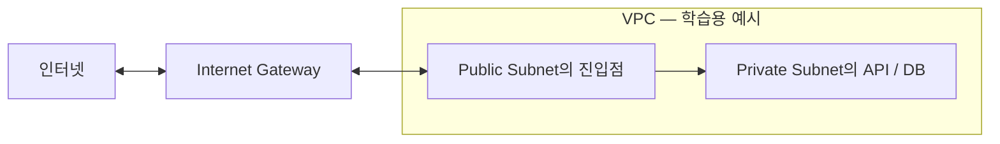

> [!info] 마케스트림 docs에서 이관한 기록
> 이전 경로: `docs/concepts/networking/vpc-subnet.md` · 이관일: 2026-11-16 · 원본 정리일: 2026-11-16. 이관 후 사용자의 요청으로 원본 파일을 정리했다. 본문 안의 날짜·구현·검증·학습 상태는 작성 당시의 기록이며, 이관·삭제만으로 현재 상태를 다시 검증한 것은 아니다.
> [이관 목차](../../projects/markestream/imported-learning.md) · [현재 대화·자기 언어 학습 방법](../../learning-workflow.md)

# VPC와 Subnet

- 갱신: 2026-11-11
- 학습 상태: 학습 중
- 프로젝트 적용: AWS 네트워크 구성은 저장소에서 미확인
- 실험 상태: 미실행

## 한 문장으로

VPC는 AWS의 가상 네트워크이고, Subnet은 그 안에서 리소스에 사용할 IP 주소 범위를 나눈 단위다.

## 왜 필요한가?

외부 요청을 받는 진입점과 내부 애플리케이션·DB를 어디에 두고 어떤 경로로 연결할지 정해야 한다. 서버를 생성하는 것과 서버까지 통신 가능한 경로를 만드는 것은 별도 작업이다.

## 어떻게 동작하는가?

서브넷은 하나의 가용 영역에 속한다. Public Subnet은 Internet Gateway로 향하는 직접 경로가 있고, Private Subnet은 그 직접 경로가 없다. 서브넷의 라우팅 테이블이 목적지별 다음 경로를 결정한다. [AWS 서브넷 문서](https://docs.aws.amazon.com/vpc/latest/userguide/configure-subnets.html)

이 그림은 역할 관계다. IPv4 EC2의 직접 인터넷 연결에는 공인 주소와 라우팅, 통신 허용 규칙 등이 함께 맞아야 한다. Public이라는 이름만으로 모든 포트가 공개되지는 않는다.

## 헷갈린 점

- Private Subnet에 있다고 모든 외부 통신이 불가능한 것은 아니다. 외부로 연결을 시작할 경로를 별도로 설계한다.
- 같은 VPC에 있어도 Security Group 등에서 허용하지 않으면 통신이 막힐 수 있다.
- VPC·Subnet은 AWS 네트워크 구성이고 Pod·Service는 Kubernetes 구성이다. 서로 다른 층의 개념이다.

## 마케스트림에서는?

현재 [Compose](file:///Users/dhkim/Desktop/ml-project/markestream/infra/compose.yaml)는 로컬 MySQL·Keycloak을 정의한다. 이는 AWS VPC를 구성하는 파일이 아니다. [스테이징 설계](../../projects/markestream/reference/05-project-cicd.md)를 실제 구축할 때 가용 영역, 진입점, 워커와 DB의 서브넷, 외부 API 호출 경로를 정해야 한다.

## 실제로 검증했는가?

미실행. AWS 라우팅 테이블과 인스턴스의 실제 통신은 확인하지 않았다.

## 문서를 덮고 답하기

1. Public과 Private을 나누는 기준은 이름인가, 라우팅인가?
2. Private 서버가 외부 API를 호출하려면 무엇을 확인할까?

내 설명 / 복습 날짜: 아직 작성하지 않음.

[NAT Gateway](nat-gateway.md) · [Security Group](security-group.md) · [위키 목차](../../projects/markestream/imported-guides/README.md)

공식 자료 확인일: 2026-11-11.

## 공통 학습 보관함에서 이어가기

[네트워크·요청 흐름 Canvas](../../maps/network-request-flow.canvas) · [함께 이관한 개념과 프로젝트 자료](../../projects/markestream/imported-learning.md)

원문에 있는 내 설명·복습 기록을 유지한다. 아직 작성하지 않은 자기 설명을 이관 과정에서 대신 채우지 않았다. 앞으로의 대화에서 이해한 내용을 자기 말로 이어 적는다.
