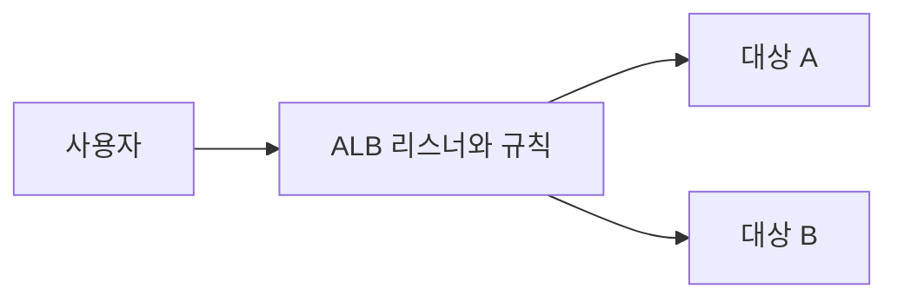

> [!info] 마케스트림 docs에서 이관한 기록
> 이전 경로: `docs/concepts/traffic/alb.md` · 이관일: 2026-11-16 · 원본 정리일: 2026-11-16. 이관 후 사용자의 요청으로 원본 파일을 정리했다. 본문 안의 날짜·구현·검증·학습 상태는 작성 당시의 기록이며, 이관·삭제만으로 현재 상태를 다시 검증한 것은 아니다.
> [이관 목차](../../projects/markestream/imported-learning.md) · [현재 대화·자기 언어 학습 방법](../../learning-workflow.md)

# ALB

- 갱신: 2026-11-11
- 학습 상태: 학습 중
- 프로젝트 적용: 도입 미확정
- 실험 상태: 미실행

## 한 문장으로

AWS Application Load Balancer는 HTTP(S) 요청을 리스너 규칙에 따라 대상 그룹으로 전달하는 관리형 로드 밸런서다.

## 왜 필요한가?

외부에 접근 지점을 제공하고 여러 애플리케이션 대상으로 요청을 나누는 역할이 필요할 때 사용한다.

## 어떻게 동작하는가?

요청은 리스너에 도착하고, 규칙이 어떤 대상 그룹으로 보낼지 정한다. 대상 그룹의 헬스 체크와 상태가 요청 전달에 영향을 준다. 호스트·경로별 라우팅도 할 수 있다. [AWS ALB 소개](https://docs.aws.amazon.com/elasticloadbalancing/latest/application/introduction.html)

모든 대상의 이상 상태 등 예외 조건도 있으므로 “헬스 체크만 있으면 무조건 무중단”이라고 판단하지 않는다.

## 헷갈린 점

ALB는 Pod 복제본을 생성하지 않는다. 요청을 전달하는 역할과 Kubernetes가 실행 상태를 복구하는 역할을 구분한다. Traefik과 라우팅 기능이 겹치므로 실제 요구에 맞게 진입점을 설계한다.

## 마케스트림에서는?

저장소에 ALB 설정은 없다. [Traefik ADR](../../projects/markestream/adr/002-traefik.md)은 기존 설계의 제안을 정리한 것이다. ALB와 Traefik을 단순한 동일 기능 제품으로 비교하지 않고, 외부 진입점·TLS·가용성·운영 부담을 함께 검토한다.

## 실제로 검증했는가?

미실행. 대상 장애와 외부 진입점 장애는 각각 검증할 항목이다.

## 문서를 덮고 답하기

1. ALB가 살아 있어도 모든 API 대상이 응답하지 않으면 어떻게 될까?
2. 요청 분산과 새 Pod 생성은 누가 담당할까?

내 설명 / 복습 날짜: 아직 작성하지 않음.

[Control Plane](../kubernetes/control-plane.md) · [위키 목차](../../projects/markestream/imported-guides/README.md)

공식 자료 확인일: 2026-11-11.

## 공통 학습 보관함에서 이어가기

[네트워크·요청 흐름 Canvas](../../maps/network-request-flow.canvas) · [함께 이관한 개념과 프로젝트 자료](../../projects/markestream/imported-learning.md)

원문에 있는 내 설명·복습 기록을 유지한다. 아직 작성하지 않은 자기 설명을 이관 과정에서 대신 채우지 않았다. 앞으로의 대화에서 이해한 내용을 자기 말로 이어 적는다.
