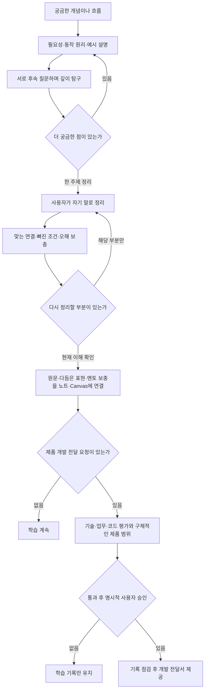

# 학습과 개발 전달 절차

[학습 홈](index.md)

## 한 번의 진행

현재 프로젝트의 Codex 채팅에서 `$learning-mentor` 한 줄로 시작한다. 전역에 연결된 스킬이 현재 프로젝트를 선택하고, 주제가 없으면 멘토가 먼저 묻는다. 노트 기록도 이 호출에 포함된다. 별도 터미널 세션은 기존 `learn` 명령을 사용한다. 공통 개념만 배우는 경우 프로젝트를 요구하지 않는다. 개념 학습에는 아래 흐름의 개발 범위·승인·전달 단계가 필요하지 않다.



학습 에이전트는 전달서 제공까지 담당한다. 제품 구현은 기존 개발 에이전트에서 별도로 진행한다. 개발 에이전트에 이 학습 게이트가 자동 강제되는 구조는 아니다.

기본은 서로 질문하며 개념과 흐름을 이해하고, 한 주제가 정리되면 사용자가 자기 말로 설명해 보는 방식이다. 멘토는 왜 필요한지·내부에서 어떻게 동작하는지·어떤 순서로 흐르는지·다른 개념과 무엇이 다른지를 실제 프로젝트와 연결해 설명한다. 사용자는 자유롭게 되묻고 멘토도 필요한 부분에서 질문한다. 정의 확인이나 맞히기 문답만 반복하지 않는다.

한 주제가 정리되거나 정리를 요청하면 사용자가 편한 문장·목록·비유로 먼저 표현한다. 멘토는 원문을 보존하고 의미를 유지해 정돈하며, 오류 수정·새 사실은 별도 보충으로 남긴다. 자기 설명이 없으면 멘토 설명이나 초안으로 두고 이해 완료를 자동 표시하지 않는다. 매 대화마다 정리를 강제해 흐름을 끊지 않는다.

원본 프로젝트는 읽기 전용이다. 코드 읽기는 설명의 근거로 사용할 수 있으며 실습·작성·실행은 사용자가 원할 때만 선택한다. 실제 제품 변경을 위한 개발 전달에는 기존 세 영역 이해 확인과 명시적 승인이 필요하다.

## 무엇을 확인하나?

| 영역 | 예: 광고주 회사 생성 |
| --- | --- |
| 기술 | 트랜잭션이 필요한 이유, 권한 검사와 DB 저장의 관계 |
| 비즈니스 | 회사 생성과 계정 생성의 차이, 어느 대행사의 누가 생성하는지 |
| 코드 | Controller → Service → 권한 판정 → 저장 → 담당 배정의 실제 파일 추적 |

멘토는 주제·현재 이해를 필요한 만큼만 먼저 묻고 기존 답변을 활용한다. 필요한 설명을 충분히 하고 사용자의 후속 질문을 따라간다. 자기 설명에서 오해·빠진 연결이 발견되면 그 부분만 보충하고 확인한다. 사용자는 언제든 질문·중단·주제 변경을 할 수 있다. 일반 개념 대화마다 위 세 영역을 모두 시험하지 않는다.

## 상태를 나눠 기록하기

- **학습:** 미평가 → 학습 중 → 이해 확인. “알겠어”만으로 통과하지 않는다.
- **구현 근거:** 코드 확인 / 설계 문서의 제안 / 이번에 실행한 결과를 구분한다.
- **실험:** 미실행 / 진행 / 실제 관찰 결과. 문서를 읽었다고 실행 완료로 바꾸지 않는다.
- **자기 설명:** 아직 정리 전 / 사용자 원문 / 의미를 유지해 정돈 / 보충할 부분 있음. 멘토 설명과 사용자 표현을 구분한다.
- **개발 전달:** 범위 미정 / 평가 대기 / 승인 대기 / 전달 가능. 학습 상태와 별개다.

사용자 답변·평가 이유·승인 문구는 세션과 평가 기록에 남긴다. 통과한 뒤 제시한 범위에 대한 명확한 승인이 있어야 개발 전달서를 제공한다. 범위나 코드가 바뀌면 그 영향만 재확인하고, 같은 유효한 범위의 승인은 반복 요청하지 않는다.

노트에는 처음 궁금했던 점, 내가 이해한 이유·흐름, 헷갈렸던 점, 프로젝트 적용, 남은 질문을 남긴다. 사용자 원문과 정돈한 표현, 멘토 보충을 구분한다. 실제로 한 실험이 있을 때만 방법·관찰을 추가한다.

기록 검증 도구가 통과해도 답변의 의미나 승인 진위를 자동으로 증명하지 않는다. 멘토가 실제 대화와 대조한다. 파일 쓰기 권한을 차단하는 보안 장치도 아니다.

## 자동 노트

명시적으로 시작한 학습 세션 안에서 멘토는 노트 스킬로 관련 개념과 세션을 갱신한다. 공통 개념은 `concepts/`, 실제 적용은 `projects/<project-id>/`, 대화는 `sessions/<project-id>/`로 나누고 서로 연결한다. 별도 상시 실행 프로세스나 다른 채팅 자동 수집은 없다. 생성 영역 밖의 사용자 필기와 이전 답변을 유지한다.

각 기술 노트에는 원본 경로·심볼·코드 해시, 실제 업무 규칙, 명세·ADR 근거를 연결한다. 코드가 바뀌면 지문 검사가 알려 주며, 내용을 다시 읽고 갱신한다. 실제 근거가 없는 설계 이유는 “멘토의 해석”으로 표시한다.

## 공부한 내용을 연결하기

[카드형 학습 지도](maps/learning-map.canvas)는 큰 주제·공통 개념·프로젝트 적용·학습 세션을 색과 그룹으로 보여 준다. 카드를 이동·확대하며 살펴보고 실제 노트 링크를 따라간다. 멘토는 학습 교환을 기록할 때 기존 배치를 유지하며 관련 가지만 추가하고 [연결 목록과 상태](maps/learning-map.md)도 갱신한다. 같은 개념을 다른 프로젝트에서 다시 만나면 기존 공통 개념 노트에 새 적용 사례를 연결한다.

그림 아래에도 실제 노트 링크를 남겨 Obsidian 그래프·백링크에서 따라갈 수 있게 한다. 선수 개념, 함께 쓰이는 원리, 비교 대상, 실제 적용처럼 연결 이유를 적는다. 코드가 실행되는 순서는 프로젝트 노트의 흐름도로, 무엇을 먼저 공부했는지는 세션과 학습 지도로 구분한다. 준비 자료·학습 중·이해 확인은 실제 답변·평가에 맞춰 표시한다.

## 사용할 요청

```text
$learning-mentor 광고주 회사 생성 흐름을 공부하고 싶어. 먼저 내 이해도를 질문해 줘.
```

```text
$learning-mentor 이 기능을 바꾸기 전에 기술·업무 규칙·관련 코드 이해도를 확인해 줘.
```

```text
$obsidian-notes 방금 질문과 답변을 실제 코드 및 설계 근거와 연결해서 정리해 줘.
```

전역 스킬 연결 후에는 어느 프로젝트 채팅에서든 `$learning-mentor`만 입력할 수 있다. 추가 주제나 경로는 선택 사항이다. `agent-learning`이나 여러 프로젝트의 상위 폴더에서 호출해 대상을 알 수 없을 때만 멘토가 프로젝트를 묻는다. 별도 채팅으로 개발을 요청할 때는 통과·승인 후 생성된 개발 전달서를 사용자가 직접 전달한다.

공통 개념 학습에서는 업무·실제 코드가 없으면 이유와 함께 `not-applicable`로 기록하고 예시 적용으로 원리 이해를 확인한다. 공통 개념 이해나 다른 프로젝트의 통과 기록을 새 프로젝트의 통과·승인으로 옮기지 않는다. 개발 전달용 기록의 범위 지문에는 프로젝트 ID·절대 경로가 포함된다.
