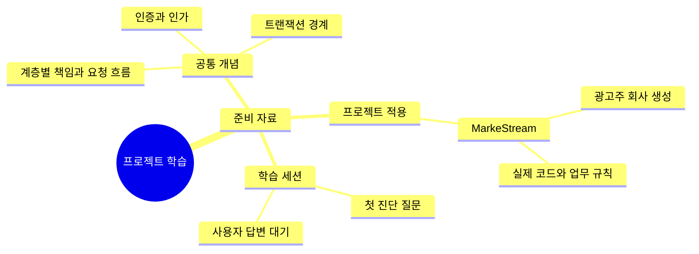
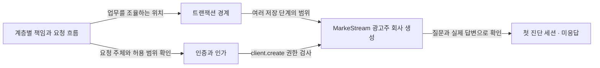

# 학습 연결 지도

[학습 홈](../index.md)

개념을 배우면 관련 원리·프로젝트 코드·실제 질문과 답변을 연결한다. 현재 아래 가지는 기존 예제를 정리한 **학습 준비 자료**다. 실제 사용자 답변이 없어 학습 완료로 표시한 주제는 없다. 학습이 진행되면 멘토가 상태와 연결을 함께 갱신한다.

## 전체 마인드맵

## 개념이 코드에 연결되는 방식

## 노트로 따라가기

- [계층별 책임과 요청 흐름](../concepts/layered-request-flow.md) ↔ [트랜잭션 경계](../concepts/transaction-boundaries.md): 업무 조율 위치와 저장 작업의 경계를 함께 이해한다.
- [계층별 책임과 요청 흐름](../concepts/layered-request-flow.md) ↔ [인증과 인가](../concepts/authentication-and-authorization.md): 요청을 처리하는 과정에서 주체·대상·권한을 확인하는 위치를 살핀다.
- 위 세 개념 ↔ [MarkeStream 광고주 회사 생성](../projects/markestream/client-company-creation.md): 실제 메서드·비즈니스 규칙·설계 근거를 확인할 사례다.
- 프로젝트 적용 ↔ [첫 진단 세션](../sessions/markestream/client-company-creation.md): 질문·답변·평가를 연결한다. 현재 상태는 미응답이다.

## 학습 순서와 상태

| 주제 | 상태 | 확인할 질문 |
| --- | --- | --- |
| 계층별 책임과 요청 흐름 | 준비 자료 | 요청은 어떤 메서드를 거쳐 응답하는가? |
| 트랜잭션 경계 | 준비 자료 | 회사 저장과 담당 배정은 어떤 범위에서 처리되는가? |
| 인증과 인가 | 준비 자료 | 로그인과 이 회사에 대한 작업 권한은 어떻게 다른가? |
| 광고주 회사 생성 적용 | 미평가 | 개념을 실제 파일과 업무 규칙에 연결해 설명할 수 있는가? |

## Obsidian에서 연결 보기

명령 팔레트에서 **Graph view: Open graph view**를 실행하면 노트 간 링크를 볼 수 있다. 개념 노트 하나를 열고 **Open local graph**를 실행하면 주변의 관련 개념·프로젝트·세션부터 볼 수 있다. 그림의 선과 별도로 위의 본문 링크가 실제 그래프 연결을 만든다. [공식 그래프 안내](https://help.obsidian.md/plugins/graph)

## 내 연결과 메모

학습자가 발견한 연결·질문을 여기에 남긴다. 지도 갱신 시 보존한다.
