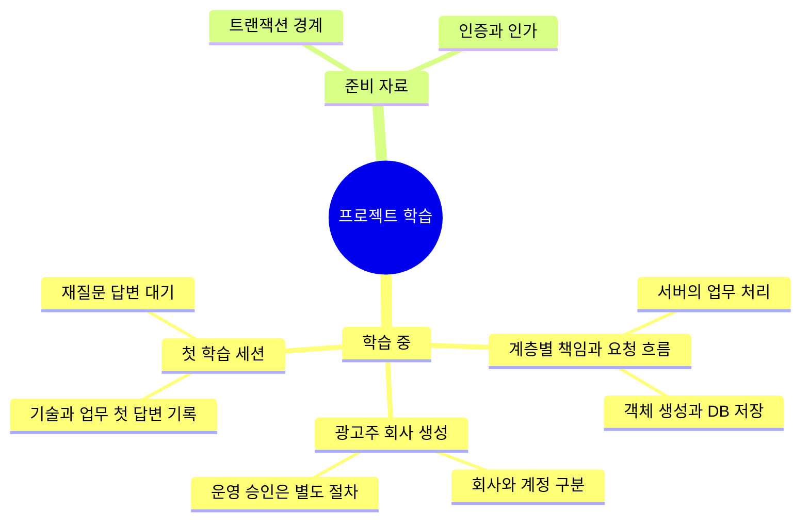
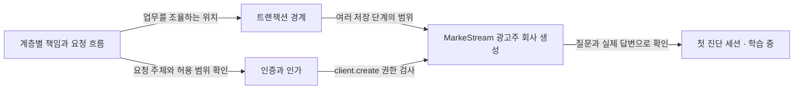

# 학습 연결 지도

[학습 홈](../index.md)

**[카드형 학습 지도 열기](learning-map.canvas)** — 색으로 개념·실제 적용·이해 확인을 나누고, 카드를 직접 이동·확대하며 살펴보는 기본 화면이다. 카드의 링크를 누르면 실제 노트로 이동한다. 아래는 관계와 상태를 기록한 문서다.

개념을 배우면 관련 원리·프로젝트 코드·실제 질문과 답변을 연결한다. 요청 흐름과 광고주 회사 생성은 첫 사용자 답변을 받아 **학습 중**이다. 다른 개념은 준비 자료이며 학습 완료로 표시한 주제는 없다. 학습이 진행되면 멘토가 상태와 연결을 함께 갱신한다.

## 지금 진행할 학습

[마케스트림 기존 기능 학습 순서](../projects/markestream/learning-roadmap.md)를 제안했다. 광고주 회사 추가 → 로그인·권한 → 회사 등록·초대 → 랜딩 편집 → 게시 → 문의·상담 순서로 확장한다. 첫 주제의 기술·업무 답변을 기록했다. 회사·계정·승인과 객체 생성·DB 저장의 차이를 보충했으며 재질문 답변을 기다린다. [현재 세션](../sessions/markestream/client-company-creation.md#기존%20기능%20학습%20시작%20—%202026-11-16)

학습자는 **서로 질문하며 개념과 흐름을 이해하고, 이해한 내용을 자기 말로 정리하는 과정**을 원한다고 설명했다. [학습 방식 정정 기록](../sessions/markestream/client-company-creation.md#학습%20방식%20정정%20—%20서로%20질문하고%20내%20말로%20정리하기)에 따라 실습은 선택 사항으로 바꾸고 사용자 원문·정돈한 표현·멘토 보충을 구분한다. 새 개념 평가 통과나 실습 실행 기록은 없다.

## 이전에 정리한 개념과 연결하기

[네트워크·요청 흐름 Canvas](network-request-flow.canvas)에서 VPC·NAT·Kubernetes·라우팅·서비스 분리를 함께 볼 수 있다. 실제 노트와 설계·세션·실험 기록은 [마케스트림 docs 이관 목차](../projects/markestream/imported-learning.md)에 모았다.

- [VPC와 Subnet](../concepts/networking/vpc-subnet.md) · [NAT Gateway](../concepts/networking/nat-gateway.md) · [Security Group](../concepts/networking/security-group.md)
- [Node와 Pod](../concepts/kubernetes/node-pod.md) · [Control Plane](../concepts/kubernetes/control-plane.md) · [Service와 Ingress](../concepts/kubernetes/service-ingress.md)
- [ALB](../concepts/traffic/alb.md) · [Traefik](../concepts/traffic/traefik.md)
- [API Gateway와 사용량 제한](../concepts/backend/api-gateway.md) · [서비스 분리와 MSA](../concepts/backend/msa.md)

이관 자료의 학습 중·미실행·설계 제안 등 원문 상태를 유지했다. 개념 관계를 나타내는 지도이며 실제 배포 경로를 확정한 그림은 아니다.

## 전체 마인드맵

## 개념이 코드에 연결되는 방식

## 노트로 따라가기

- [계층별 책임과 요청 흐름](../concepts/layered-request-flow.md) ↔ [트랜잭션 경계](../concepts/transaction-boundaries.md): 업무 조율 위치와 저장 작업의 경계를 함께 이해한다.
- [계층별 책임과 요청 흐름](../concepts/layered-request-flow.md) ↔ [인증과 인가](../concepts/authentication-and-authorization.md): 요청을 처리하는 과정에서 주체·대상·권한을 확인하는 위치를 살핀다.
- 위 세 개념 ↔ [MarkeStream 광고주 회사 생성](../projects/markestream/client-company-creation.md): 실제 메서드·비즈니스 규칙·설계 근거를 확인할 사례다.
- 프로젝트 적용 ↔ [첫 진단 세션](../sessions/markestream/client-company-creation.md): 질문·답변·평가를 연결한다. 현재는 첫 답변 수신 후 보충·재질문 단계다.

## 학습 순서와 상태

| 주제 | 상태 | 확인할 질문 |
| --- | --- | --- |
| 계층별 책임과 요청 흐름 | 학습 중 | 요청은 어떤 메서드를 거쳐 응답하는가? |
| 트랜잭션 경계 | 준비 자료 | 회사 저장과 담당 배정은 어떤 범위에서 처리되는가? |
| 인증과 인가 | 준비 자료 | 로그인과 이 회사에 대한 작업 권한은 어떻게 다른가? |
| 광고주 회사 생성 적용 | 학습 중 · 코드 답변 대기 | 개념을 실제 파일과 업무 규칙에 연결해 설명할 수 있는가? |

## Obsidian에서 연결 보기

명령 팔레트에서 **Graph view: Open graph view**를 실행하면 노트 간 링크를 볼 수 있다. 개념 노트 하나를 열고 **Open local graph**를 실행하면 주변의 관련 개념·프로젝트·세션부터 볼 수 있다. 그림의 선과 별도로 위의 본문 링크가 실제 그래프 연결을 만든다. [공식 그래프 안내](https://help.obsidian.md/plugins/graph)

## 내 연결과 메모

학습자가 발견한 연결·질문을 여기에 남긴다. 지도 갱신 시 보존한다.
