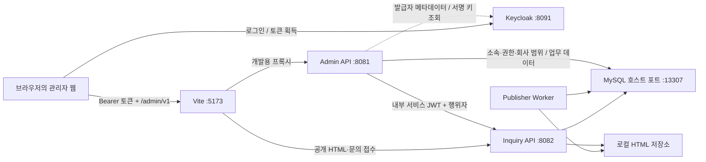
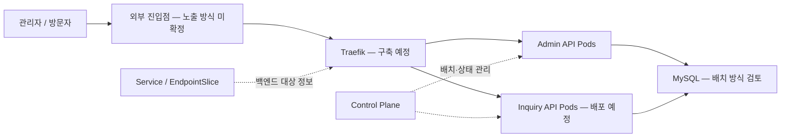

> [!info] 마케스트림 docs에서 이관한 기록
> 이전 경로: `docs/architecture/system-overview.md` · 이관일: 2026-11-16 · 원본 정리일: 2026-11-16. 이관 후 사용자의 요청으로 원본 파일을 정리했다. 본문 안의 날짜·구현·검증·학습 상태는 작성 당시의 기록이며, 이관·삭제만으로 현재 상태를 다시 검증한 것은 아니다.
> [이관 목차](../imported-learning.md) · [현재 대화·자기 언어 학습 방법](../../../learning-workflow.md)

# 현재 시스템과 요청 흐름

[위키 목차](../imported-guides/README.md) · [목표 아키텍처](../reference/02-system-architecture.md)

- 확인일: 2026-11-11
- 확인 기준: 계정·회사 분리와 권한그룹 변경을 포함한 현재 작업 트리. 상세 기준은 [권한 명세](../reference/07-permissions.md).
- 확인 수준: 별도 MySQL 8.4.11·테스트용 OIDC·Inquiry HTTP·Worker 자동 검증과 개발용 Keycloak을 통한 브라우저 게시·접수·상담 변경 확인. AWS 배포 검증은 하지 않았다. 백엔드 정리 근거는 [ADR-003](../adr/003-backend-code-conventions.md)에 있다.

## 지금 구현된 범위

| 구성 | 현재 확인한 내용 | 근거 |
| --- | --- | --- |
| 관리자 웹 | React·Vite, Keycloak 로그인, 대행사·팀원·광고주·랜딩·문의 페이지 | [프로젝트 README](file:///Users/dhkim/Desktop/ml-project/markestream/README.md), [인증 초기화](file:///Users/dhkim/Desktop/ml-project/markestream/apps/admin-web/src/features/session/session.ts) |
| 로컬 진입점 | `127.0.0.1:5173`에서 관리자 요청은 8081로, 공개 페이지·접수·스크립트는 8082로 프록시 | [Vite 설정](file:///Users/dhkim/Desktop/ml-project/markestream/apps/admin-web/vite.config.ts) |
| Admin API | 계정·대행사·팀원·광고주·랜딩 초안·게시 요청·문의 프록시 | [AccountController](file:///Users/dhkim/Desktop/ml-project/markestream/backend/admin-api/src/main/java/com/markestream/admin/account/api/AccountController.java), [AgencyCompanyController](file:///Users/dhkim/Desktop/ml-project/markestream/backend/admin-api/src/main/java/com/markestream/admin/agency/api/AgencyCompanyController.java), [ClientCompanyController](file:///Users/dhkim/Desktop/ml-project/markestream/backend/admin-api/src/main/java/com/markestream/admin/clientcompany/api/ClientCompanyController.java) |
| 인증·인가 | JWT 검증, 내부 사용자 매핑, 활성 계정·소속·권한그룹·회사 범위 확인 | [SecurityConfiguration](file:///Users/dhkim/Desktop/ml-project/markestream/backend/admin-api/src/main/java/com/markestream/admin/common/security/SecurityConfiguration.java), [AccountService](file:///Users/dhkim/Desktop/ml-project/markestream/backend/admin-api/src/main/java/com/markestream/admin/account/application/AccountService.java), [PermissionAccessService](file:///Users/dhkim/Desktop/ml-project/markestream/backend/admin-api/src/main/java/com/markestream/admin/permission/application/PermissionAccessService.java) |
| MySQL·Keycloak | Compose의 개발용 서비스와 로컬 포트 | [Compose](file:///Users/dhkim/Desktop/ml-project/markestream/infra/compose.yaml) |
| DB 스키마 | 앱 시작 시 Flyway 적용, JPA 스키마 검증 설정 | [application.yml](file:///Users/dhkim/Desktop/ml-project/markestream/backend/admin-api/src/main/resources/application.yml), [SQL](file:///Users/dhkim/Desktop/ml-project/markestream/database/migrations/V1__create_markestream_mvp.sql) |
| Inquiry·Publisher | 실행 가능한 공개·내부 문의 서비스와 비동기 게시 작업자 | [Inquiry](file:///Users/dhkim/Desktop/ml-project/markestream/backend/inquiry-api/README.md), [Publisher](file:///Users/dhkim/Desktop/ml-project/markestream/backend/publisher-worker/README.md) |

## 현재 로컬 요청 경로

다음 그림은 현재 설정대로 실행했을 때의 경로다. 기본 로컬 주소 기준이며 환경 변수로 변경할 수 있다.

로그인·토큰 갱신 경로와 업무 API 호출을 구분한다. Admin API가 JWT를 검증한다고 모든 업무 요청을 Keycloak에 전달한다는 뜻은 아니다.

## 광고주 등록 요청을 따라가기

1. 브라우저에서 로그인하고, 초기 사용자 등록 `PUT /admin/v1/me`를 거친다.
2. 광고주 등록 시 [웹 API 클라이언트](file:///Users/dhkim/Desktop/ml-project/markestream/apps/admin-web/src/features/session/AuthenticatedApi.ts)가 토큰을 갱신할 필요가 있는지 확인하고, `POST /admin/v1/agency-companies/{agencyCompanyId}/client-companies`를 보낸다.
3. Vite 개발 서버가 `/admin/v1` 요청을 Admin API로 전달한다.
4. Spring Security가 JWT를 검증한다. Controller는 경로 ID와 이름 입력을 검증한다.
5. ClientCompanyService가 PermissionAccessService를 통해 client.create 권한과 활성 계정·소속을 확인한다. 정책 분류 행의 공유 잠금은 저장이 끝날 때까지 정책·소속 변경과 경쟁하지 않게 한다.
6. ClientCompany를 생성해 저장하고 직원 생성자에게 담당 광고주를 배정한다. application 결과를 HTTP 응답 record로 반환한다.

JWT가 유효하다는 것과 특정 대행사의 데이터를 수정할 권한이 있다는 것은 별도 판단이다. 소속이 없는 대행사에 대한 현재 코드의 응답은 `404`이며, 소속은 있지만 등록 권한이 없는 계정은 `403`이다.

실행으로 확인하는 절차는 [로컬 요청 흐름 실험](../labs/local-request-flow.md)에 있다.

게시 스냅샷·임대 세대·접수 멱등성과 로컬 내부 토큰의 구현 선택은 [ADR-004](../adr/004-mvp-runtime.md)에 있다.

## 앞으로 구축할 스테이징 흐름

아래는 [기존 설계](../reference/05-project-cicd.md)에 있는 목표를 학습용으로 묶은 것이다. 현재 실행 중인 인프라를 묘사한 그림이 아니다.

Traefik에서 Pod로 가는 경로는 설정에 따라 Service ClusterIP를 경유할 수 있다. [Service와 Ingress 노트](../../../concepts/kubernetes/service-ingress.md)에서 규칙·논리적 대상·실제 패킷 경로를 구분한다. 게시 작업자, 공개 HTML 저장소 등 전체 목표 범위는 기존 아키텍처 문서에서 다룬다.

## 아직 확인하지 않은 항목

- AWS 계정의 실제 VPC·Subnet·Security Group·NAT·ALB 상태
- Kubernetes 클러스터, 매니페스트, Traefik 버전과 배포 상태
- 외부 진입점의 장애 복구, TLS, 도메인, readiness 설정
- API Gateway·Redis 기반 고객사 사용량 제한
- 운영 IdP의 서비스 계정 연계, 원격 HTML 저장소, 서비스별 DB 계정·권한

## 구조가 바뀔 때 갱신하기

실제 설정 파일이 추가되면 표의 근거와 그림을 함께 고친다. 채택한 설계는 ADR에, 관찰한 동작은 Lab에 연결한다. 목표 설계와 현재 구현의 차이가 사라졌다는 판단은 실제 확인 범위만큼만 기록한다.
