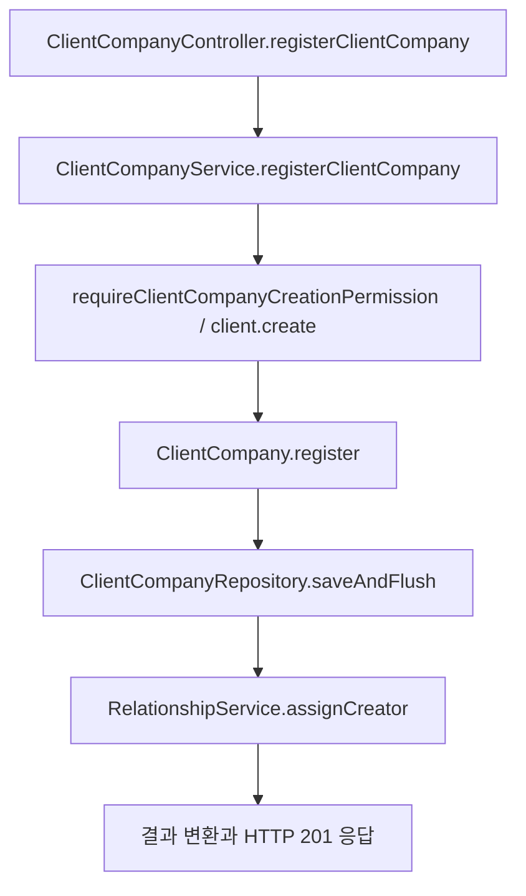

# 광고주 회사 생성과 권한 경계

[학습 목차](../../index.md)

<!-- learning:auto:start -->
<!-- learning:context {"kind": "project", "project_id": "markestream"} -->
확인일: 2026-11-16 · 이번 학습의 제품 실행 검증: 미실행

프로젝트: `markestream` · 코드 읽기 확인 · Git HEAD: `29e92c92952efe86ddeea18000245df77535f24a`. 개별 해시는 커밋되지 않은 파일 내용도 포함한다.

## 한 문장으로

광고주 회사 생성은 인증된 사용자의 대행사 범위와 client.create 권한을 확인한 뒤 회사를 저장하고 필요한 담당 관계를 연결하는 업무다.

## 왜 필요한가

로그인 성공만으로 모든 대행사의 광고주를 만들 수는 없다. 회사라는 업무 데이터와 로그인 계정도 별도로 관리해야 한다. 생성 중 일부 단계만 저장되는 문제를 피하려면 업무의 트랜잭션 경계를 이해해야 한다.

## 비즈니스 규칙

- 광고주 회사는 관리 대행사에 연결된다. 회사와 광고주 이용자 계정은 별도 개념이다.
- PermissionAccessService의 생성 권한 검사는 client.create에 대한 쓰기 권한 검사로 연결된다. 토큰 인증만으로 이 권한이 충족되지는 않는다.
- 실제 ClientCompanyService는 회사 저장 뒤 RelationshipService.assignCreator를 호출한다. 원본 권한 명세는 생성자가 대행사 직원이면 담당 관계를 연결한다고 설명한다.
- 회사 생성만으로 회사 심사 승인이나 광고주 계정 가입·초대 수락이 완료되지는 않는다. 회사 등록·검증·초대 명세를 함께 확인해야 한다.

## 실제 처리 흐름

Controller가 인증 주체와 입력을 전달하고, Service의 @Transactional 메서드가 권한 확인·생성·저장·담당 배정을 조율한다. saveAndFlush 호출은 그 자체로 전체 트랜잭션 커밋이 끝났다는 뜻이 아니다. 여기서는 코드와 선언을 읽었으며 실제 오류·롤백 실험은 수행하지 않았다.

## 설계 근거와 해석

명시된 근거: backend/AGENTS.md는 api → application → domain/repository 책임과 application의 트랜잭션 조율을 정한다. ADR-005는 회사·계정 분리와 권한 판정의 선택 이유를 기록한다.

멘토의 해석: 이 분리는 HTTP 입력 처리, 업무 권한, 회사 상태, DB 접근을 각각 추적하기 쉽게 한다. 작성자의 추가 의도나 실제 성능 효과까지 확인한 것은 아니다. 구체적인 권한 동시성 규칙은 관련 구현과 ADR을 읽고 별도로 검증한다.

## 실제 코드와 설계 근거

외부 파일 링크는 원본 파일을 여는 용도다. 경로·심볼은 원본 저장소 기준이고, 행은 심볼의 첫 출현 위치를 찾는 힌트다.

- [backend/admin-api/src/main/java/com/markestream/admin/clientcompany/api/ClientCompanyController.java](file:///Users/dhkim/Desktop/ml-project/markestream/backend/admin-api/src/main/java/com/markestream/admin/clientcompany/api/ClientCompanyController.java) · `registerClientCompany` · 62행 부근
  - 근거: 등록 HTTP 진입점, 인증 주체와 입력 변환, 201 응답 선언
  - SHA-256: `bff107ba428db8005c479034074d7065f156f88d468a4b34915cef0c0c88de3d`
<!-- learning:source {"path": "backend/admin-api/src/main/java/com/markestream/admin/clientcompany/api/ClientCompanyController.java", "symbol": "registerClientCompany", "sha256": "bff107ba428db8005c479034074d7065f156f88d468a4b34915cef0c0c88de3d", "project_id": "markestream", "project_root": "/Users/dhkim/Desktop/ml-project/markestream"} -->

- [backend/admin-api/src/main/java/com/markestream/admin/clientcompany/application/ClientCompanyService.java](file:///Users/dhkim/Desktop/ml-project/markestream/backend/admin-api/src/main/java/com/markestream/admin/clientcompany/application/ClientCompanyService.java) · `registerClientCompany` · 126행 부근
  - 근거: 트랜잭션 안의 권한 확인, 회사 생성, 저장, 담당 배정 순서
  - SHA-256: `c0e59ded655f84d3e492e837674e4a747f47c8de12d288cec993bee5fab0e92e`
<!-- learning:source {"path": "backend/admin-api/src/main/java/com/markestream/admin/clientcompany/application/ClientCompanyService.java", "symbol": "registerClientCompany", "sha256": "c0e59ded655f84d3e492e837674e4a747f47c8de12d288cec993bee5fab0e92e", "project_id": "markestream", "project_root": "/Users/dhkim/Desktop/ml-project/markestream"} -->

- [backend/admin-api/src/main/java/com/markestream/admin/permission/application/PermissionAccessService.java](file:///Users/dhkim/Desktop/ml-project/markestream/backend/admin-api/src/main/java/com/markestream/admin/permission/application/PermissionAccessService.java) · `requireClientCompanyCreationPermission` · 201행 부근
  - 근거: 회사 생성 권한이 client.create 쓰기 권한 검사에 연결됨
  - SHA-256: `9588cbc9788d37709f49dc37b5445a5e887f2cdcdaf39fb83bbcf6f09e5c6542`
<!-- learning:source {"path": "backend/admin-api/src/main/java/com/markestream/admin/permission/application/PermissionAccessService.java", "symbol": "requireClientCompanyCreationPermission", "sha256": "9588cbc9788d37709f49dc37b5445a5e887f2cdcdaf39fb83bbcf6f09e5c6542", "project_id": "markestream", "project_root": "/Users/dhkim/Desktop/ml-project/markestream"} -->

- [backend/admin-api/src/main/java/com/markestream/admin/clientcompany/domain/ClientCompany.java](file:///Users/dhkim/Desktop/ml-project/markestream/backend/admin-api/src/main/java/com/markestream/admin/clientcompany/domain/ClientCompany.java) · `register` · 70행 부근
  - 근거: 대행사 ID와 이름·시각을 받는 회사 도메인 생성
  - SHA-256: `e2eb9bff90dad5dd6f56d2089056ee66644c180ee9fe9305b37d71c1abacd92d`
<!-- learning:source {"path": "backend/admin-api/src/main/java/com/markestream/admin/clientcompany/domain/ClientCompany.java", "symbol": "register", "sha256": "e2eb9bff90dad5dd6f56d2089056ee66644c180ee9fe9305b37d71c1abacd92d", "project_id": "markestream", "project_root": "/Users/dhkim/Desktop/ml-project/markestream"} -->

- [backend/admin-api/src/main/java/com/markestream/admin/permission/application/RelationshipService.java](file:///Users/dhkim/Desktop/ml-project/markestream/backend/admin-api/src/main/java/com/markestream/admin/permission/application/RelationshipService.java) · `assignCreator` · 222행 부근
  - 근거: 생성자 종류에 따른 담당 관계 연결
  - SHA-256: `724ac11d70aa7ef7b1c6ca837015ad8d8fcb237f1c6da7b54dfbba0489b29b20`
<!-- learning:source {"path": "backend/admin-api/src/main/java/com/markestream/admin/permission/application/RelationshipService.java", "symbol": "assignCreator", "sha256": "724ac11d70aa7ef7b1c6ca837015ad8d8fcb237f1c6da7b54dfbba0489b29b20", "project_id": "markestream", "project_root": "/Users/dhkim/Desktop/ml-project/markestream"} -->

- [backend/AGENTS.md](file:///Users/dhkim/Desktop/ml-project/markestream/backend/AGENTS.md)
  - 근거: 현재 프로젝트의 계층별 책임과 트랜잭션 기준
  - SHA-256: `6f19614303852d7d5b64881274d0b49415925327be649547f791df6a7b35fd0e`
<!-- learning:source {"path": "backend/AGENTS.md", "symbol": "", "sha256": "6f19614303852d7d5b64881274d0b49415925327be649547f791df6a7b35fd0e", "project_id": "markestream", "project_root": "/Users/dhkim/Desktop/ml-project/markestream"} -->

- [docs/07-permissions.md](file:///Users/dhkim/Desktop/ml-project/markestream/docs/07-permissions.md)
  - 근거: 회사·계정·소속·담당 관계와 권한의 비즈니스 의미
  - SHA-256: `3c2ba88fc33ad89f87d90e11123bcfa186714e8709fea1988dc49d4748049b46`
<!-- learning:source {"path": "docs/07-permissions.md", "symbol": "", "sha256": "3c2ba88fc33ad89f87d90e11123bcfa186714e8709fea1988dc49d4748049b46", "project_id": "markestream", "project_root": "/Users/dhkim/Desktop/ml-project/markestream"} -->

- [docs/08-registration.md](file:///Users/dhkim/Desktop/ml-project/markestream/docs/08-registration.md)
  - 근거: 회사 생성 이후 등록 심사와 계정 초대의 별도 흐름
  - SHA-256: `e121ceabce72ea5827d782dbe26671e6ff06ba310ae39a7f0f5504bdfbbc6f75`
<!-- learning:source {"path": "docs/08-registration.md", "symbol": "", "sha256": "e121ceabce72ea5827d782dbe26671e6ff06ba310ae39a7f0f5504bdfbbc6f75", "project_id": "markestream", "project_root": "/Users/dhkim/Desktop/ml-project/markestream"} -->

- [docs/adr/005-account-permission-groups.md](file:///Users/dhkim/Desktop/ml-project/markestream/docs/adr/005-account-permission-groups.md)
  - 근거: 회사와 계정을 분리한 명시적인 설계 결정
  - SHA-256: `80b184ffeaa130f65cab0a7e11d5e2fb36ea0a2476f8fbfcd5354fd96c138b35`
<!-- learning:source {"path": "docs/adr/005-account-permission-groups.md", "symbol": "", "sha256": "80b184ffeaa130f65cab0a7e11d5e2fb36ea0a2476f8fbfcd5354fd96c138b35", "project_id": "markestream", "project_root": "/Users/dhkim/Desktop/ml-project/markestream"} -->

## 문서를 덮고 답하기

1. 회사 저장 뒤 담당 배정에서 예외가 나면 트랜잭션에 어떤 결과를 기대하며, 어떤 테스트로 확인할까?
2. 광고주 회사 생성과 광고주 이용자 가입·초대 수락은 어떻게 다른가?
3. Controller, Service, 권한 서비스, Repository의 역할과 실제 호출 위치를 찾아 설명할 수 있는가?
<!-- learning:auto:end -->

## 내 설명과 질문

아직 답변하지 않음. 이 영역은 자동 갱신 시 보존된다.
