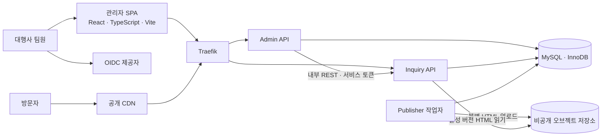

> [!info] 마케스트림 docs에서 이관한 기록
> 이전 경로: `docs/02-system-architecture.md` · 이관일: 2026-11-16 · 원본 정리일: 2026-11-16. 이관 후 사용자의 요청으로 원본 파일을 정리했다. 본문 안의 날짜·구현·검증·학습 상태는 작성 당시의 기록이며, 이관·삭제만으로 현재 상태를 다시 검증한 것은 아니다.
> [이관 목차](../imported-learning.md) · [현재 대화·자기 언어 학습 방법](../../../learning-workflow.md)

# AdDock 시스템 아키텍처

**구현 계약 v0.3 · 2026-11-11**

React 관리자 화면과 두 Spring Boot API를 각각 배포한다. Admin API는 대행사와 랜딩 편집을, Inquiry API는 공개 페이지와 문의를 담당한다. 첫 버전은 MySQL 하나를 공유하며 각 서비스의 쓰기 권한을 테이블별로 제한한다. 비동기 게시 작업자는 초안의 스냅샷을 HTML로 렌더링한다.

## 구성 요소와 데이터 책임

| 구성 요소 | 책임과 권한 |
| --- | --- |
| Admin API | OIDC 사용자 식별, 대행사 권한 확인, 광고주·랜딩·초안 작성, 게시 작업 등록, 게시 중단. 문의 읽기와 상태 변경은 Inquiry API를 호출한다. |
| Inquiry API | 공개 키로 활성 랜딩과 폼 조회, HTML 제공, 문의 검증과 접수, 문의 상태와 이력 관리. 내부 요청에서 활성 계정·그룹·대상 정책·회사 범위를 다시 확인한다. |
| Publisher | 작업 가져오기, 초안 스냅샷으로 HTML 생성, 게시 버전과 폼 버전 생성, 활성 버전 전환. 서비스별 MySQL 권한에서 랜딩 갱신은 활성 포인터와 갱신 시각으로 좁힌다. |
| MySQL | 편집·게시·문의 업무 데이터와 게시 큐. Admin과 Publisher가 게시 관련 테이블을 분담하고 Inquiry가 문의와 문의 이력을 쓴다. |
| 오브젝트 저장소 | 릴리스 키와 작업 세대를 포함한 불변 HTML. Publisher는 해당 경로에 쓰고 Inquiry는 읽는다. S3를 스테이징 후보로 둔다. |
| Traefik과 공개 CDN | 관리 호스트의 `/admin/v1/**`를 Admin API에, 공개 호스트의 `/p/**`와 `/api/public/v1/**`를 Inquiry API에 라우팅한다. 내부 API는 클러스터 Service로만 제공한다. |

관리자 SPA와 API는 같은 관리 호스트에 둔다. 공개 HTML과 문의 제출은 같은 공개 호스트에 둔다. CDN은 `/p/**` 및 `/api/public/v1/**` 응답을 캐시하지 않는 정책으로 설정한다. Inquiry API가 요청마다 활성 버전을 조회해 저장소의 HTML을 전달하므로 버전 교체와 게시 중단의 기준점이 DB 한 곳이다. 버전 HTML과 스냅샷에는 문의 응답·연락처를 넣지 않는다. 공개 이미지 URL은 HTTPS를 허용하고 방문자 브라우저가 직접 가져온다. 배포 전에 Content Security Policy를 실제 렌더러의 이미지·스크립트 정책과 맞춘다.

## 편집부터 게시까지

1. Admin API가 랜딩과 기본 폼, 초안 리비전 1을 만든다. 편집기는 저장 시 읽었던 리비전을 보내고 Admin API는 리비전 일치 조건으로 초안을 갱신한다.
2. 게시 요청은 저장된 리비전을 지정한다. Admin API가 랜딩 행을 잠그고 해당 리비전의 스냅샷, 불변 `release_key`, 요청 키를 저장한 후 `202`와 작업 ID를 반환한다. 랜딩당 진행 중인 작업은 하나다. 편집기는 작업 ID로 상태를 조회한다.
3. Publisher는 `QUEUED` 또는 임대가 만료된 `RUNNING` 작업을 원자적으로 선점한다. 선점할 때 작업 세대를 증가시키고 임대 시각을 기록한다. HTML은 `releases/{publicPageKey}/{releaseKey}/{claimVersion}/index.html`에 업로드한다. 세대별 경로를 쓰므로 임대가 만료된 작업자가 새 작업의 HTML을 덮어쓸 수 없다.
4. Publisher는 랜딩 행을 잠근 뒤 작업의 현재 세대와 유효한 임대를 확인한다. 같은 DB 트랜잭션에서 게시 버전과 폼 버전을 저장하고, 랜딩 활성 포인터와 작업 상태를 각각 새 버전과 `SUCCEEDED`로 갱신한다. 업로드 또는 DB 기록 실패는 공개 중인 버전에 영향을 주지 않는다. 일정 횟수 후 작업을 `FAILED`로 기록하며 DB 참조가 없는 업로드는 유예 기간 후 정리한다.
5. 게시 중단은 랜딩 행 잠금 아래 진행 중인 작업이 없는지 확인하고 활성 포인터를 비운다. 게시와 중단이 충돌하면 UI가 작업 상태를 보여준다. 활성 버전 교체와 문의 제출 사이의 경쟁은 Inquiry API가 접수 트랜잭션에서 같은 랜딩 행을 잠가 처리한다.

사용자 입력은 버전이 있는 블록 스키마로 검증한다. HTML 생성 시 텍스트를 이스케이프하고 링크 스킴과 이미지 URL을 검사한다. 폼의 동의 문구는 렌더된 HTML과 폼 스냅샷에 함께 들어간다.

## 문의 접수와 상태 변경

공개 페이지는 제출할 때 자신의 `releaseKey`와 `Idempotency-Key`를 보낸다. Inquiry API는 공개 페이지 키로 소속을 결정하고, 같은 요청의 재전송 여부를 먼저 판정한다. 새로운 요청이면 활성 버전과 폼을 확인하고 폼 규칙과 동의를 검사한 뒤 저장한다. 폐기된 폼은 `409 STALE_RELEASE`, 게시가 중단된 주소의 새 요청은 `404`를 돌려준다. 이전에 성공한 동일 요청은 게시 중단 후에도 같은 접수 번호를 반환한다.

공개 경로에는 복제본 전체에 적용되는 요청 속도 제한과 본문 크기 제한을 건다. 공개 원본은 신뢰할 수 있는 CDN 경로로 접근하도록 제한하고, 전달 헤더는 신뢰한 프록시에서 받은 것만 사용한다. 제한치와 스팸 방어 수단은 파일럿 트래픽으로 조정한다. 관리자 목록에는 접수 번호·광고주·랜딩·상태·시간을 표시하고 상세 화면에서 응답 원문을 제공한다. 상태 변경과 변경 이력은 한 트랜잭션으로 처리한다.

## 인증과 관측

Admin API는 토큰의 issuer·audience·만료와 account_type/azp 조합을 검증하고 계정 종류별 테이블에 매핑한다. 현재 기능 권한과 회사 범위는 effective_access_grants 뷰로 확인한다. 시스템 계정은 전체 대행사 범위이며 일반 계정은 소속·담당 관계로 제한한다. [권한 명세](07-permissions.md)와 [ADR-005](../adr/005-account-permission-groups.md)를 적용한다.

내부 서비스 JWT에는 actor_type·actor_id·agency_company_id를 서명해 포함한다. Inquiry API는 호출 서비스와 대상 대행사를 확인한 뒤 현재 계정의 권한을 재검사한다. 브라우저 행위자 헤더를 사용하지 않는다. 권한 변경과 업무 쓰기는 정책 행 잠금과 READ_COMMITTED로 조율하며 HTTP 호출 중에는 DB 잠금을 유지하지 않는다. 원격 배포 시 TLS와 네트워크 정책을 적용한다.

요청 ID를 관리자, Inquiry API, 게시 작업 로그에 전달한다. 게시 처리 시간, 큐 대기 시간, 문의 저장 실패율과 공개 HTML 오류를 지표로 기록한다. 공개 제출 본문, 관리자 응답 원문, 인증 토큰은 로그 필터에서 제외한다.

## 적용 환경

로컬은 Docker Compose의 MySQL과 파일 저장소 어댑터를 쓴다. 스테이징은 기존 대화의 EC2 3대, kubeadm, Traefik 구성을 기준으로 계획한다. 테스트 DB는 MySQL StatefulSet 1개와 EBS PVC를 검토한다. EBS 볼륨과 노드의 가용 영역을 맞춰야 하며, 운영 DB로는 RDS MySQL을 우선 평가한다. [Kubernetes StatefulSet](https://kubernetes.io/docs/concepts/workloads/controllers/statefulset/) · [Amazon EBS 볼륨](https://docs.aws.amazon.com/ebs/latest/userguide/ebs-volumes.html)

[PRD](01-prd.md) · [ERD](03-erd.md) · [프로젝트와 배포](05-project-cicd.md)
