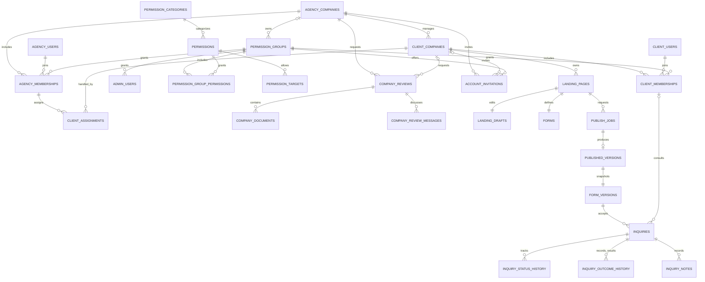

> [!info] 마케스트림 docs에서 이관한 기록
> 이전 경로: `docs/03-erd.md` · 이관일: 2026-11-16 · 원본 정리일: 2026-11-16. 이관 후 사용자의 요청으로 원본 파일을 정리했다. 본문 안의 날짜·구현·검증·학습 상태는 작성 당시의 기록이며, 이관·삭제만으로 현재 상태를 다시 검증한 것은 아니다.
> [이관 목차](../imported-learning.md) · [현재 대화·자기 언어 학습 방법](../../../learning-workflow.md)

# AdDock 데이터 모델과 ERD

구현 계약 v0.11 · 2026-11-13. 실제 정의는 [V1](file:///Users/dhkim/Desktop/ml-project/markestream/database/migrations/V1__create_markestream_mvp.sql) → [V2](file:///Users/dhkim/Desktop/ml-project/markestream/database/migrations/V2__public_request_limits.sql) → [V3](file:///Users/dhkim/Desktop/ml-project/markestream/database/migrations/V3__accounts_and_permission_groups.sql) → [V4](file:///Users/dhkim/Desktop/ml-project/markestream/database/migrations/V4__company_registration_and_invitations.sql) → [V5](file:///Users/dhkim/Desktop/ml-project/markestream/database/migrations/V5__inquiry_assignees_and_notes.sql) → [V6](file:///Users/dhkim/Desktop/ml-project/markestream/database/migrations/V6__inquiry_outcomes.sql) → [V7](file:///Users/dhkim/Desktop/ml-project/markestream/database/migrations/V7__inquiry_follow_up.sql) → [V8](file:///Users/dhkim/Desktop/ml-project/markestream/database/migrations/V8__inquiry_notifications.sql) → [V9](file:///Users/dhkim/Desktop/ml-project/markestream/database/migrations/V9__inquiry_duplicate_contacts.sql) → [V10](file:///Users/dhkim/Desktop/ml-project/markestream/database/migrations/V10__company_business_check_reason.sql) → [V11](file:///Users/dhkim/Desktop/ml-project/markestream/database/migrations/V11__company_review_messages.sql) 순서로 적용한다. 적용된 마이그레이션은 수정하지 않는다.

## 계정과 권한 테이블

| 테이블 | 주요 연결과 제약 |
| --- | --- |
| agency_companies | 대행사 회사, 이름, disabled_at |
| client_companies | 광고주 회사, agency_company_id. (agency_company_id,id) 유일 |
| agency_users / client_users | 계정 종류별 issuer+subject 유일, disabled_at |
| admin_users | 시스템 계정, 공통 그룹 참조. ADMIN_USER 타입 복합 FK |
| agency_memberships | (agency_company_id,agency_user_id) PK, 그룹·소유 대행사·타입 복합 FK, revoked_at |
| client_memberships | (agency_company_id,client_company_id,client_user_id) PK. 회사·그룹 소유 대행사를 복합 FK로 검사 |
| client_assignments | 같은 대행사의 직원 소속과 광고주 회사 연결, revoked_at |
| permission_categories | 기능 분류와 정렬 |
| permissions | 코드 PK, 분류, AGENCY/CLIENT/SYSTEM 업무 영역, row_version |
| permission_targets | (permission_code,target_type) PK |
| permission_groups | 소유 대행사와 대상 타입, 이름, client_scope, 기본 템플릿 키, row_version |
| permission_group_permissions | (permission_group_id,permission_code) PK |

권한 정의와 기본 그룹, 범위, 마지막 관리자 보호는 [권한 명세](07-permissions.md)에 있다. audit_logs와 시스템 지정 대행사 테이블은 없다. effective_access_grants는 권한을 중복 저장하는 테이블이 아닌 읽기 전용 뷰다.

## 게시·문의 데이터

랜딩·폼·초안·게시 작업·게시 버전·폼 버전·문의·문의 이력의 테넌트 열은 agency_company_id이며 광고주 회사는 client_company_id다. 회사·랜딩·버전의 복합 FK와 공개 키 유일 제약을 유지한다. 초안 revision과 문의 row_version은 조건부 갱신하며, 랜딩별 진행 중 게시 작업은 생성 컬럼 고유키로 하나만 허용한다.

publish_jobs의 requested_by_agency_user_id / requested_by_client_user_id / requested_by_admin_user_id, inquiry_status_history의 changed_by_* 중 각각 정확히 하나가 채워져야 한다. 기존 행위자 ID는 agency 참조로 보존한다. 공개 버전·폼 스냅샷과 문의 응답은 재게시 후에도 유지하며 원문을 게시 스냅샷에 넣지 않는다.

문의 목록은 회사 범위 조건을 SQL에 적용하고 submitted_at DESC,id DESC로 조회한다. 기존 테넌트·광고주·랜딩·상태별 인덱스를 유지한다. V2의 public_request_limits는 해시 IP 키와 분 단위 창으로 공유 요청 제한을 처리한다.

V3는 기존 회사·계정 ID를 유지하면서 테이블 이름과 참조를 이전한다. 생성 컬럼이 있는 publish_jobs는 종속 FK를 일시 해제하고 이름 변경 후 복구한다. [이전 테스트](file:///Users/dhkim/Desktop/ml-project/markestream/backend/admin-api/src/test/java/com/markestream/admin/PermissionMigrationTest.java)가 이전 역할·게시·문의 이력을 검증한다.

## V4: 등록·심사·초대

[회사 등록 명세](08-registration.md)의 상태와 제약을 따른다. 회사에 사업자 정보·approved_review_id, 계정에 이름·이메일·인증 시각을 추가했다. company_reviews는 회사별 버전 있는 신청 스냅샷이며 진행 중 신청은 회사당 하나다. company_documents는 신청별 비공개 첨부 메타데이터, account_invitations는 계정 종류·회사·그룹에 묶인 단일 수락 초대와 메일 전달 상태다. 기존 회사는 승인 참조가 NULL이며 기존 ID는 유지된다. 신청·승인 정보와 파일은 공개 랜딩 저장소와 분리한다. 실제 컬럼·FK·인덱스는 V4를 기준으로 한다.

## 문의 상담 담당자·메모 (V5)

`inquiries.assigned_client_user_id`는 미배정이면 NULL이며 `(agency_company_id,client_company_id,assigned_client_user_id)` 복합 FK로 같은 광고주 회사의 `client_memberships`만 참조한다. 회사 단위 대행사 직원 담당 관계인 `client_assignments`와 별개다. 배정에는 문의 조회·처리 권한과 활성 계정·소속이 필요하며 배정 자체가 권한을 부여하지 않는다. 소속·권한 회수 시 기존 참조를 보존하고 재배정 필요로 표시한다.

`inquiry_notes`는 회사·문의 복합 FK, 본문(공백 제거 후 최대 2,000자), 세 종류 중 하나의 작성자 FK, 작성자 이름 스냅샷, 작성 시각, 요청 UUID를 저장한다. `(agency_company_id,inquiry_id,request_key)`는 유일하다. 메모는 추가·조회만 제공하며 문의의 상태·버전을 변경하지 않는다. 상태 이력에도 `changed_by_name`을 저장하며 기존 이름은 이전 시점의 프로필로 채운다. 기존 문의는 미배정이고 기존 그룹에는 새 권한을 자동 추가하지 않는다.

문의 검색·기간·특정 담당자 필터는 기존 `answers_json`·`receipt_code`·`submitted_at`·`assigned_client_user_id`를 조회하므로 스키마를 추가하지 않는다. 부분 검색은 Querydsl 안의 MySQL JSON 값 검색으로 수행하며 기존 회사/접수일/담당자 인덱스로 범위를 좁힌다. 응답 원문을 별도 검색 테이블에 복제하지 않는다.

## 상담 결과 (V6)

`inquiries.outcome`은 UNRECORDED·CONTRACTED·NOT_INTERESTED·UNREACHABLE·OTHER 중 하나이며 `outcome_note`는 선택적인 최대 1,000자 메모다. 기존/신규 문의의 기본값은 미기록이며, 기존 CLOSED를 계약 성사 등으로 추정하지 않는다. 상태·담당자·결과 변경은 같은 row_version을 사용한다. 결과를 바꾸어도 진행 상태는 유지하고 상담을 재개해도 결과를 지우지 않는다.

`inquiry_outcome_history`는 회사·문의 복합 FK와 `(inquiry_id,row_version)` PK, 전후 결과·메모, 세 종류 중 하나의 변경자 FK, 이름 스냅샷·시각을 보관한다. 결과 수정과 이력 추가는 같은 트랜잭션이다. 동일 결과·정규화된 메모는 버전이나 이력을 늘리지 않는다. 미기록으로 초기화하면 현재 결과 메모는 NULL이 되고 이전 내용은 이력에 남는다. 전체 감사 로그 테이블은 추가하지 않는다.

## 문의 재연락 일정 (V7)

`inquiries`에 `follow_up_status`(NONE/PENDING/COMPLETED), `follow_up_date`(DATE), `follow_up_task`(1,000자), `follow_up_completed_at`(밀리초)을 둔다. 문의당 현재 일정 한 건이며 담당자는 기존 `assigned_client_user_id`를 따른다. 진행 상태·상담 결과와 독립적이고 기존 문의는 미예약으로 시작한다. 취소는 현재 날짜·할 일·완료 시각을 NULL로 만든다. PENDING에는 날짜·할 일, COMPLETED에는 완료 시각도 필수이며 CHECK로 상태 조합을 보호한다. `(agency_company_id,follow_up_status,follow_up_date,id)` 인덱스를 사용한다.

`inquiry_follow_up_history`는 회사·문의 복합 FK, `(inquiry_id,row_version)` PK, 전후 상태·날짜·할 일·완료 시각, 세 종류 중 하나의 변경자 FK와 이름·시각을 보관한다. 현재 일정 변경과 같은 트랜잭션이며 문의의 버전을 공유한다. 취소 후에도 이력은 남는다. 전체 audit_logs는 추가하지 않는다.

## 문의 알림 (V8)

`inquiry_notifications`는 새 접수(RECEIVED), 담당 배정(ASSIGNED), 재연락 예정(FOLLOW_UP_DUE)의 업무 이벤트를 저장한다. 문의·회사 복합 FK, 대상 광고주 직원 FK, 원본 버전·일정 날짜·발생 시각과 중복 방지 키를 가진다. 접수·배정 이벤트는 원본 저장과 같은 트랜잭션이며 공개 접수의 재전송은 이벤트를 추가하지 않는다. 새 접수는 현재 권한 범위의 공유 알림이므로 수신자별 행을 복제하지 않는다. 배정·예정 알림은 대상 직원과 현재 문의 담당자가 같아야 보인다.

`inquiry_notification_reads`는 이벤트와 계정 종류별 FK(직원/광고주/시스템 중 정확히 하나), 최초 읽음 시각을 보관한다. 이벤트+각 계정 FK UNIQUE로 동시에 읽음 처리해도 한 건이며 최초 시각을 유지한다. 다른 종류의 같은 숫자 계정 ID와 읽음 상태를 섞지 않는다. 문의·알림 삭제 시 관련 알림·읽음 행을 함께 삭제한다. 전역 감사 로그나 고객 원문 복제는 추가하지 않는다.

재연락 이벤트의 원본 버전은 가장 최근 `inquiry_follow_up_history.row_version`이다. 상태·상담 결과·담당자 수정만으로 같은 일정 알림을 반복하지 않고, 일정 변경 후에는 이전 알림을 숨긴다. 기존 접수·배정을 소급 생성하지 않으며 기존 PENDING 일정은 오전 9시 이후/기한 지남 조건에 맞으면 처리한다. 기존 그룹의 권한은 늘리지 않는다.

## 중복 문의 연락처 비교 (V9)

`inquiry_contact_indexes`는 문의별 비교 완료 표시이며 문의·회사 복합 FK, 키/정규화 버전 지문과 준비 시각을 보관한다. 비교할 값이 없는 문의도 완료 행을 두어 미준비와 연락처 없음을 구분한다. `inquiry_contact_keys`는 문의·항목 종류(PHONE/EMAIL)·32바이트 HMAC-SHA256 해시의 PK와 `(kind,contact_hash,inquiry_id)` 조회 인덱스를 가진다. 원본 문의 삭제 시 두 메타데이터도 삭제된다. 같은 회사의 여러 랜딩·폼 버전 사이에서도 비교하고 다른 광고주 회사의 연락처는 섞지 않는다.

접수 당시 폼의 PHONE/EMAIL 필드 ID로 응답을 읽는다. 전화번호 구분 문자와 명시적 한국 국가번호 +82/0082를 정리하고 이메일은 앞뒤 공백·대소문자만 정리한다. 점/플러스 별칭은 합치지 않는다. 해시에는 대행사·광고주 회사·항목 종류를 포함하므로 회사나 종류가 다른 값의 지문을 공유하지 않는다. 비교용 정규화 원문을 DB에 복제하지 않으며 고객의 원래 응답도 수정하지 않는다.

신규 접수와 비교 메타데이터는 하나의 트랜잭션이다. 기존 문의는 정책 공유 잠금·문의 행 잠금 아래 최대 100건씩 준비하며 문의 자체의 행 버전·진행 상태·결과·답변·이력을 변경하지 않는다. GET 조회는 준비 작업을 수행하지 않는다. 준비가 끝나기 전에는 확정 0건 대신 준비 중을 반환한다. 키/정규화 버전이 바뀌면 비교 완료를 다시 확인하고 백그라운드에서 재구성한다. V9은 기존 권한그룹을 자동 갱신하지 않는다.

## 등록 문의 대화 (V11)

`company_review_messages`는 신청 ID·대행사 ID의 복합 FK로 대화를 신청 범위에 묶는다. 작성자는 `author_agency_user_id` / `author_client_user_id` / `author_admin_user_id` 중 정확히 하나이며 DB CHECK와 FK로 제한한다. `author_name`은 작성 당시 표시 이름, `body`는 최대 2,000자, `created_at`은 UTC DATETIME(3)다. `(review_id,request_key)` 고유키는 재시도를 단일 메시지로 만든다. `(agency_company_id,review_id,id)` 인덱스로 권한 범위와 최신순 커서 조회를 지원한다. 심사 내부 근거는 기존 `company_reviews`에 유지하며 대화로 복사하지 않는다.
